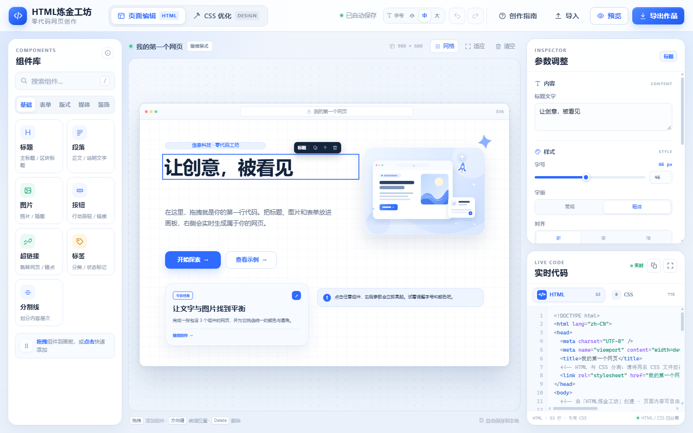
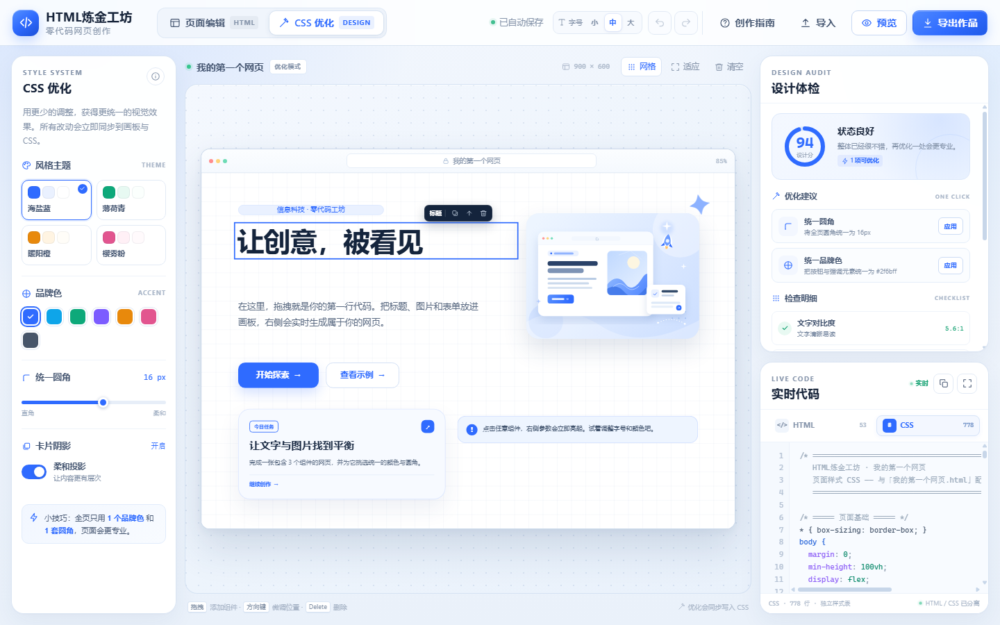
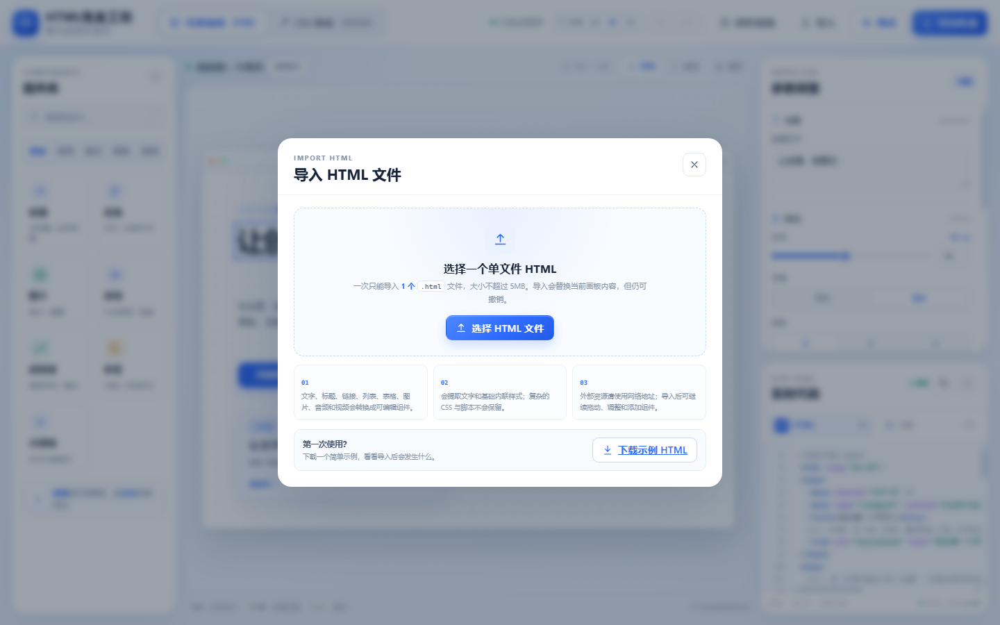

# HTML炼金工坊 · 零代码网页创作

面向初二学生的零代码网页创建工具。无需后端与构建步骤，打开页面即可通过「拖拽 + 参数调整」完成一张网页作品，并实时查看生成的 HTML / CSS。

## 打开方式

推荐在项目目录中启动本地静态服务器：

```powershell
python -m http.server 8000
```

然后访问 <http://127.0.0.1:8000/>。

也可以直接双击 `index.html` 打开；建议使用最新版 Chrome 或 Edge。

## 界面预览

**页面编辑：**



**CSS 优化：**



**导入 HTML：**



## 功能一览

### 页面编辑

- **组件库**：基础、表单、版式、媒体、装饰五个分类，包含标题、段落、图片、按钮、超链接、标签、分割线、联系表单、输入框、多行文本、下拉菜单、复选框、内容卡片、引用块、提示条、列表、表格、音频、视频、光晕、星标贴纸与装饰图标。
- **两种添加方式**：把组件拖到画板任意位置，或点击组件快速添加。
- **画板操作**：拖动组件调整位置；方向键微调；`Delete` 删除；`Ctrl + D` 复制；支持撤销 / 重做。
- **参数面板**：按组件类型提供文字、颜色、字号、字重、对齐、行高、圆角、投影、宽度、坐标与图层顺序等参数；标题字重仅保留「常规 / 粗体」两档。
- **实时代码**：右侧下方将 HTML 与 CSS 独立生成，点击 `HTML` / `CSS` 标签即可切换查看；自动高亮、显示行数，可复制或放大查看。
- **独立文件**：HTML 通过 `<link rel="stylesheet">` 引用同名 CSS 文件，代码结构更清晰。
- **图片**：支持网络图片地址、本地图片上传、圆角、比例、填充方式与投影。
- **自动保存**：作品保存在浏览器本地，刷新页面后可继续编辑。
- **预览 / 导出**：支持桌面、平板、手机三种预览宽度；可分别下载 HTML 与 CSS，也可下载合并后的单文件 HTML。
- **界面字号**：顶部提供「小 / 中 / 大」三档切换，默认中号；选择会保存在浏览器中，再次打开仍沿用上次设置。

### 导入 HTML

- 顶部「导入」按钮一次只能选择一个 `.html` / `.htm` 文件，大小不超过 5MB。
- 导入会替换当前画板内容，但支持撤销。
- 标题、段落、链接、图片、列表、表格、音频和视频会转换为可编辑组件。
- 会读取文字和内联样式；样式表规则、脚本与外部资源不会自动打包。
- 提供可直接下载的简单示例：[examples/example-page.html](examples/example-page.html)。

### CSS 优化

- 切换顶部「CSS 优化」后，左侧变为主题与设计变量面板，右侧上部变为设计体检，右下方代码面板会自动切换到 CSS 标签。
- **主题预设**：海盐蓝、薄荷青、暖阳橙、樱雾粉。
- **设计变量**：品牌色、统一圆角、卡片投影。
- **设计体检**：实时检查文字对比度、字号层级、圆角统一、配色克制度与组件重叠，并给出可一键应用的建议。
- 所有优化会立即同步到画板与 CSS 代码，并支持撤销。
- 在 CSS 优化模式下仍可点击 `HTML` 标签查看页面结构。

## 快捷键

| 快捷键 | 功能 |
| --- | --- |
| `Ctrl + Z` | 撤销 |
| `Ctrl + Shift + Z` / `Ctrl + Y` | 重做 |
| `Ctrl + D` | 复制选中组件 |
| `Delete` / `Backspace` | 删除选中组件 |
| `方向键` | 移动 1px |
| `Shift + 方向键` | 移动 10px |
| `/` | 聚焦组件搜索 |
| `Esc` | 取消选择 / 关闭弹窗 |

## 文件结构

```
ZeroCodeHTML/
├─ index.html           页面结构、图标与弹窗
├─ styles.css           工作台界面样式
├─ app.js               组件数据、画板交互、代码生成、优化与导出
├─ examples/
│  └─ example-page.html  可导入的单文件示例网页
└─ assets/
   ├─ hero.svg          默认示例插画
   └─ hero-data.js      导出时内嵌插画的 data URI
```

## 设计说明

- 画板逻辑尺寸为 **900 × 600**，界面会随窗口自动等比缩放。
- 界面与画板采用蓝白灰浅色主题，交互动画保持克制，减少课堂环境中的视觉干扰。
- HTML 与 CSS 分开展示；分开下载时请将 `.html` 与同名 `.css` 文件放在同一目录。
- 单文件 HTML 导出会自动合并 CSS，并把默认插画内嵌，适合直接分享。
- 音频和视频默认使用网络示例地址，可替换为自己的媒体链接；外部媒体需要联网播放。
- 不收集任何数据；自动保存仅使用浏览器 `localStorage`。
